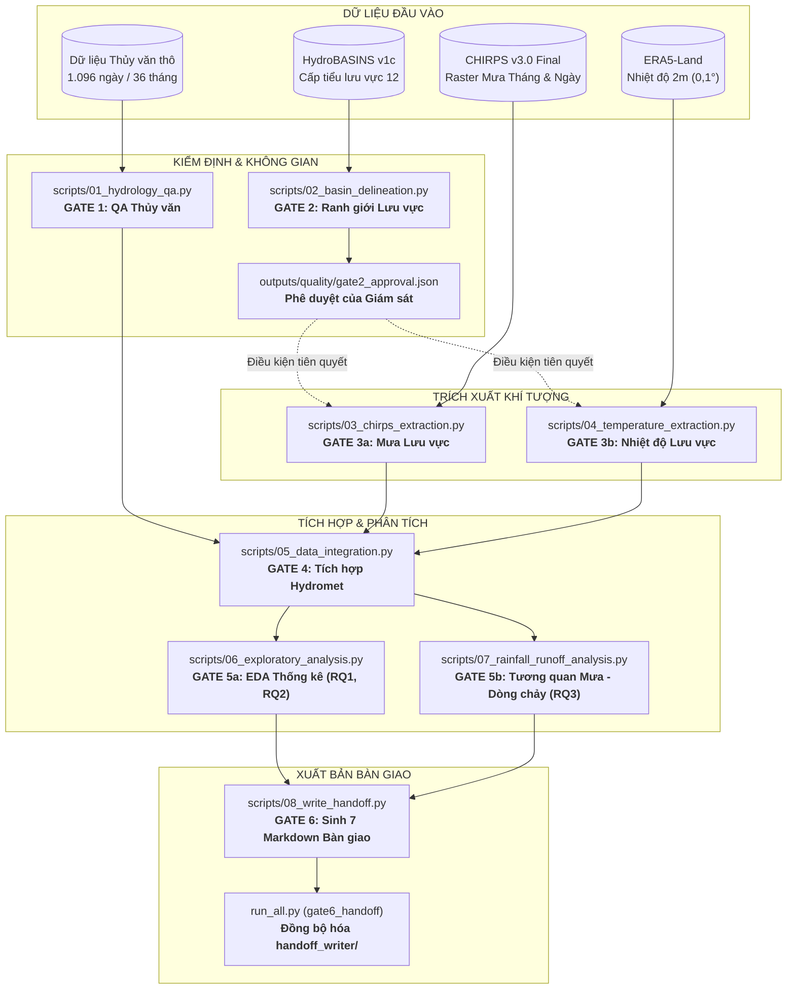

# Nghiên cứu Dữ liệu Khí tượng Thủy văn — Lưu vực sông Ba đến Thủy điện Sông Ba Hạ (2023–2025)

<div align="center">

[-red.svg)](https://portal.ptit.edu.vn/)
[](#m%E1%BB%A5c-ti%C3%AAu-v%C3%A0-c%C3%A2u-h%E1%BB%8Fi-nghi%C3%AAn-c%E1%BB%A9u)
[-brightgreen.svg)](#h%E1%BB%87-th%E1%BB%91ng-c%E1%BB%95ng-nghi%E1%BB%87m-thu-gate-16)
[-orange.svg)](#k%E1%BA%BFt-qu%E1%BA%A3-ch%C3%ADnh)
[](https://www.python.org/)
[](#h%E1%BB%87-th%E1%BB%91ng-c%E1%BB%95ng-nghi%E1%BB%87m-thu-gate-16)
[](#h%C6%B0%E1%BB%9Bng-d%E1%BA%ABn-ch%E1%BA%A1y-quy-tr%C3%ACnh)

</div>

> **Trạng thái cập nhật 28/10/2026:** Trưởng nhóm đã chạy lại QA thủy văn từ 1.096 ngày, tích hợp GATE 4, phân tích GATE 5 và bàn giao GATE 6 thành công. GATE 3 sử dụng bộ khí tượng đã bàn giao (không tái tải đầy đủ từ raw trong vòng nghiệm thu này). Polygon lưu vực và phương pháp mưa CHIRPS xấp xỉ **ĐÃ ĐƯỢC CHẤP NHẬN CÓ ĐIỀU KIỆN** cho tiểu luận: so sánh 36 tháng với diện tích giao pixel cho sai lệch tương đối tuyệt đối trung bình **0,4477%**, tối đa **1,3952%**; chênh lệch 377/379 pixel chưa giải thích hết. Hai kịch bản lưu lượng `SUSPECT` có thể làm đảo thứ tự lag 0/lag 1. **ĐẠT RÀ SOÁT KỸ THUẬT CÓ ĐIỀU KIỆN, CHƯA NGHIỆM THU TOÀN ĐỀ TÀI, CHƯA MERGE PR #9.** Không có đủ dữ liệu thô trên GitHub để chứng minh tái lập end-to-end. Xem [quyết định nghiệm thu](docs/OWNER_DECISIONS_2026-10-27.md), [trạng thái QA](docs/QA_EXECUTION_STATUS_2026-10-27.md) và [PR #9](../../pull/9).

---

## 📑 Mục lục

- [1. Mục tiêu và Câu hỏi Nghiên cứu](#1-mục-tiêu-và-câu-hỏi-nghiên-cứu)
- [2. Kiến trúc Hệ thống và Quy trình Pipeline](#2-kiến-trúc-hệ-thống-và-quy-trình-pipeline)
- [3. Cấu trúc Thư mục Dự án](#3-cấu-trúc-thư-mục-dự-án)
- [4. Yêu cầu Cài đặt Môi trường](#4-yêu-cầu-cài-đặt-môi-trường)
- [5. Chuẩn bị Dữ liệu Đầu vào](#5-chuẩn-bị-dữ-liệu-đầu-vào)
- [6. Hướng dẫn Chạy Quy trình](#6-hướng-dẫn-chạy-quy-trình)
  - [Chạy toàn bộ tự động (End-to-End)](#chạy-toàn-bộ-tự-động-end-to-end)
  - [Kiểm tra trạng thái hệ thống](#kiểm-tra-trạng-thái-hệ-thống)
  - [Chạy phân đoạn từ một GATE cụ thể](#chạy-phân-đoạn-từ-một-gate-cụ-thể)
  - [Chạy độc lập từng script thành phần](#chạy-độc-lập-từng-script-thành-phần)
  - [Cơ chế chạy lại và ghi đè dữ liệu (Idempotency)](#cơ-chế-chạy-lại-và-ghi-đè-dữ-liệu-idempotency)
- [7. Hệ thống Cổng Nghiệm thu (GATE 1–6)](#7-hệ-thống-cổng-nghiệm-thu-gate-16)
- [8. Kênh Dữ liệu và Phương pháp Xử lý Không gian](#8-kênh-dữ-liệu-và-phương-pháp-xử-lý-không-gian)
- [9. Kết quả Nghiên cứu Cốt lõi](#9-kết-quả-nghiên-cứu-cốt-lõi)
  - [Ranh giới thủy văn lưu vực (GATE 2)](#ranh-giới-thủy-văn-lưu-vực-gate-2)
  - [RQ1 — Đặc trưng Khí tượng (Mưa & Nhiệt độ)](#rq1--đặc-trưng-khí-tượng-mưa--nhiệt-độ)
  - [RQ2 — Đặc trưng Thủy văn (Lưu lượng & Mực nước)](#rq2--đặc-trưng-thủy-văn-lưu-lượng--mực-nước)
  - [RQ3 — Mối liên hệ Thống kê Mưa – Dòng chảy](#rq3--mối-liên-hệ-thống-kê-mưa--dòng-chảy)
  - [Kiểm tra Độ nhạy với Ngoại lệ](#kiểm-tra-độ-nhạy-với-ngoại-lệ)
- [10. Danh mục Ấn phẩm Bàn giao (Handoff Kit)](#10-danh-mục-ấn-phẩm-bàn-giao-handoff-kit)
- [11. Giới hạn Khoa học và Quyết định Kỹ thuật](#11-giới-hạn-khoa-học-và-quyết-định-kỹ-thuật)
- [12. Tài liệu Tham khảo và Trích dẫn](#12-tài-liệu-tham-khảo-và-trích-dẫn)

---

## 1. Mục tiêu và Câu hỏi Nghiên cứu

Nghiên cứu được thiết kế theo phương pháp **Phân tích Khám phá Dữ liệu (Exploratory Data Analysis — EDA)** và thống kê tương quan trên lưu vực sông Ba tính đến công trình Thủy điện Sông Ba Hạ trong giai đoạn 3 năm (01/01/2023 – 31/12/2025).

> [!NOTE]
> **Ranh giới học thuật:** Nghiên cứu không suy diễn quan hệ nhân quả tuyệt đối từ hệ số tương quan; không xây dựng mô hình học máy (Machine Learning) hay mô phỏng thủy văn phức tạp khi chuỗi số liệu quan trắc mới dừng ở mức 3 năm ngắn hạn.

Dự án tập trung giải quyết 3 câu hỏi nghiên cứu trọng tâm:

* **RQ1 — Khí tượng:** Lượng mưa, nhiệt độ và tính mùa trên lưu vực biến động như thế nào trong chuỗi 36 tháng (2023–2025)?
* **RQ2 — Thủy văn:** Lưu lượng nước về hồ và mực nước thượng lưu biến động ra sao theo ngày, tháng, năm; có những thời kỳ dòng chảy hoặc sự kiện cực đoan nào đáng chú ý?
* **RQ3 — Kết hợp:** Lượng mưa trên lưu vực và lưu lượng nước về hồ có mối liên hệ thống kê như thế nào? Mối liên hệ thay đổi ra sao theo độ trễ thời gian (Lag 0, Lag 1 tháng), theo mùa (mùa khô vs mùa mưa) và khi loại bỏ các yếu tố mùa vụ (Deseasonalised)?

---

## 2. Kiến trúc Hệ thống và Quy trình Pipeline

Quy trình xử lý dữ liệu được thiết kế thành một đường ống tuyến tính, kiểm soát chặt chẽ bằng các điều kiện nghiệm thu cổng (Gates) từ khâu dữ liệu thô tới khâu xuất bản tài liệu:



---

## 3. Cấu trúc Thư mục Dự án

```text
doankhdl/
├── docs/                                  # Đặc tả kỹ thuật và quy trình gốc
│   ├── DAC_TA_NGHIEN_CUU_V1.0.md          # Đặc tả yêu cầu nghiên cứu V1.0
│   ├── PHU_LUC_TRIEN_KHAI_V1.1.md          # Phụ lục hướng dẫn triển khai kỹ thuật V1.1
│   └── WORKFLOW.md                        # Quy trình phối hợp và tiêu chí nghiệm thu PR
│
├── data/
│   ├── raw/                               # Dữ liệu thô (được chặn khỏi Git qua .gitignore)
│   │   ├── hydrology/                     # Gói số liệu vận hành thủy văn Sông Ba Hạ (36 tháng)
│   │   ├── chirps/                        # Bộ đệm GeoTIFF mưa CHIRPS v3.0 Final
│   │   ├── era5_land/                     # Bộ đệm JSON nhiệt độ lưới ERA5-Land
│   │   └── boundaries/                    # Tệp HydroBASINS level 12 và OSM reference
│   ├── interim/                           # Tệp xử lý trung gian
│   └── processed/                         # Dữ liệu sạch, bảng tích hợp và GeoJSON lưu vực
│       ├── hydrology_clean.csv            # Chuỗi thủy văn sạch 1.096 ngày kèm cờ chất lượng
│       ├── hydrology_exceptions.csv       # Danh mục 35 bản ghi nghi vấn/ngoại lệ
│       ├── rainfall_daily.csv             # Chuỗi mưa ngày 1.096 ngày
│       ├── rainfall_monthly.csv           # Chuỗi mưa tháng 36 tháng
│       ├── temperature_daily.csv          # Chuỗi nhiệt độ ngày 1.096 ngày
│       ├── temperature_monthly.csv        # Chuỗi nhiệt độ tháng 36 tháng
│       ├── hydromet_daily.csv             # Bảng tích hợp ngày (1.096 dòng)
│       ├── hydromet_monthly.csv           # Bảng tích hợp tháng (36 dòng)
│       └── song_ba_ha_catchment.geojson   # Đa giác ranh giới lưu vực chính thức
│
├── scripts/                               # Mã nguồn thực thi 6 Cổng Nghiệm thu
│   ├── 01_hydrology_qa.py                 # GATE 1: Kiểm định 1.096 ngày dữ liệu thủy văn
│   ├── 02_basin_delineation.py            # GATE 2: Delineate lưu vực từ HydroBASINS & OSM
│   ├── 03_chirps_extraction.py            # GATE 3a: Trích xuất mưa CHIRPS v3 có trọng số diện tích
│   ├── 04_temperature_extraction.py       # GATE 3b: Trích xuất nhiệt độ ERA5-Land 2m
│   ├── 05_data_integration.py             # GATE 4: Tích hợp dữ liệu ngày và tháng, chạy 11 kiểm tra QA
│   ├── 06_exploratory_analysis.py         # GATE 5a: Thống kê mô tả & trực quan EDA (RQ1 & RQ2)
│   ├── 07_rainfall_runoff_analysis.py     # GATE 5b: Phân tích tương quan mưa – dòng chảy (RQ3)
│   └── 08_write_handoff.py                # GATE 6: Tự động biên soạn 7 tài liệu handoff chuẩn hóa
│
├── outputs/                               # Sản phẩm kết xuất kỹ thuật
│   ├── figures/                           # Đồ thị F02–F10 (PNG ≥ 200 dpi)
│   ├── maps/                              # Bản đồ F01 (PNG ≥ 200 dpi)
│   ├── tables/                            # Bảng số liệu T01–T07 (CSV)
│   └── quality/                           # Báo cáo QA, phương pháp luận và gate2_approval.json
│
├── handoff_writer/                        # Bộ bàn giao trọn gói độc lập cho người viết báo cáo
│   ├── 01_project_overview.md             # Tổng quan bối cảnh, công trình và mục tiêu
│   ├── 02_data_sources_and_methods.md     # Mô tả chi tiết nguồn dữ liệu, phương pháp và công thức
│   ├── 03_data_quality_summary.md         # Báo cáo kiểm định chất lượng và xử lý ngoại lệ
│   ├── 04_results_and_interpretation.md   # Diễn giải kết quả thống kê trả lời RQ1, RQ2, RQ3
│   ├── 05_limitations.md                  # Giới hạn nghiên cứu và ranh giới diễn giải
│   ├── 06_figures_and_tables_index.md     # Mục lục tra cứu toàn bộ hình ảnh và bảng biểu
│   ├── 07_references.md                   # Danh mục tài liệu tham khảo chuẩn học thuật
│   ├── figures/                           # 10 biểu đồ và bản đồ (F01–F10)
│   ├── tables/                            # 8 bảng kết quả thống kê (T01–T07, T02b)
│   └── selected_data/                     # 10 tệp dữ liệu đã làm sạch và tích hợp
│
├── run_all.py                             # Bộ điều phối thực thi pipeline toàn diện
├── requirements.txt                       # Danh mục thư viện Python phụ thuộc
└── README.md                              # Tài liệu hướng dẫn chính của dự án
```

---

## 4. Yêu cầu Cài đặt Môi trường

Dự án yêu cầu phiên bản **Python $\ge 3.11$** (khuyến nghị `Python 3.12` hoặc `3.13`).

### Bước 1: Khởi tạo và kích hoạt môi trường ảo

```bash
# Di chuyển vào thư mục dự án
cd "d:/PTIT/Khoa học dữ liệu/doankhdl"

# Khởi tạo môi trường ảo Python
python -m venv .venv
```

Kích hoạt môi trường ảo:
* **Windows (PowerShell):**
  ```powershell
  .venv\Scripts\Activate.ps1
  ```
* **Windows (Command Prompt):**
  ```cmd
  .venv\Scripts\activate.bat
  ```
* **Linux / macOS:**
  ```bash
  source .venv/bin/activate
  ```

### Bước 2: Nâng cấp pip và cài đặt thư viện phụ thuộc

```bash
python -m pip install --upgrade pip
pip install -r requirements.txt
```

> [!TIP]
> **Các thư viện địa không gian & khoa học dữ liệu chính:** `geopandas`, `shapely`, `pyproj`, `rasterio`, `rioxarray`, `pandas`, `numpy`, `scipy`, `matplotlib`, `requests`.

---

## 5. Chuẩn bị Dữ liệu Đầu vào

Theo quy định tại [WORKFLOW.md](docs/WORKFLOW.md), gói dữ liệu thủy văn gốc 36 tháng của Thủy điện Sông Ba Hạ được lưu hành nội bộ và bảo mật qua `.gitignore`.

Trước khi chạy lần đầu, hãy đảm bảo gói số liệu đã được giải nén đúng cấu trúc tại `data/raw/hydrology/`:

```text
data/raw/hydrology/
├── song_ba_ha_202301_to_202512.csv   # [Bắt buộc] Tệp CSV hợp nhất 1.096 ngày
├── raw_csv/                          # 36 tệp CSV tải về theo từng tháng
├── raw_html/                         # 36 tệp trang HTML lưu trữ gốc
├── normalized/                       # 36 tệp CSV chuẩn hóa cấu trúc
├── qa_monthly.csv                    # Bảng QA sơ bộ ban đầu
└── run_metadata.json                 # Metadata thời gian thu thập
```

> [!NOTE]
> Các nguồn dữ liệu raster mưa **CHIRPS v3.0**, nhiệt độ **ERA5-Land** và ranh giới **HydroBASINS** sẽ được pipeline **tự động tải về và lưu vào bộ nhớ đệm** tại `data/raw/` ngay trong lần chạy đầu tiên; người dùng không cần phải tải thủ công.

---

## 6. Hướng dẫn Chạy Quy trình

Pipeline điều phối [run_all.py](run_all.py) được xây dựng với cơ chế kiểm soát lỗi nghiêm ngặt: nếu bất kỳ GATE nào gặp sự cố hoặc trả về mã lỗi khác 0, toàn bộ tiến trình sẽ dừng lại ngay lập tức để bảo toàn tính toàn vẹn dữ liệu.

### Chạy toàn bộ tự động (End-to-End)

Để thực thi liên hoàn từ GATE 1 đến GATE 6, chỉ cần chạy một lệnh duy nhất:

```bash
python run_all.py
```

Tiến trình sẽ tuần tự:
1. Thực hiện QA 1.096 ngày thủy văn.
2. Delineate ranh giới lưu vực và đối chiếu diện tích $11.115\text{ km}^2$.
3. Kiểm tra chữ ký phê duyệt tại `outputs/quality/gate2_approval.json`.
4. Trích xuất chuỗi mưa CHIRPS v3 Final (tháng và ngày).
5. Trích xuất nhiệt độ ERA5-Land (tháng và ngày).
6. Tích hợp dữ liệu thành bảng ngày/tháng và chạy 11 kiểm tra QA.
7. Tạo toàn bộ bảng thống kê và vẽ 10 biểu đồ độ phân giải $\ge 200\text{ dpi}$.
8. Tự động biên soạn 7 tài liệu handoff và đồng bộ hóa `handoff_writer/`.

---

### Kiểm tra trạng thái hệ thống

> Lưu ý: dòng `✅` do `run_all.py --status` báo là trạng thái **tệp đầu ra/điều kiện xử lý**, không phải chứng nhận đã tái lập dữ liệu gốc từ đầu hoặc nghiệm thu khoa học cuối.

Để kiểm tra nhanh hiện trạng hoàn thành của các cổng nghiệm thu mà không chạy lại tính toán:

```bash
python run_all.py --status
```

*Đầu ra chuẩn:*
```text
============================================================
  TRẠNG THÁI PIPELINE
============================================================
  ✅ GATE 1
  ✅ GATE 2 (kỹ thuật)
  ✅ GATE 3a — mưa ngày
  ✅ GATE 3b — nhiệt độ
  ✅ GATE 4
  ✅ GATE 5
  ✅ GATE 6

  Phê duyệt GATE 2: CONDITIONAL (chấp nhận polygon xấp xỉ; không phải nghiệm thu cuối)
```

---

### Chạy phân đoạn từ một GATE cụ thể

Khi cần tinh chỉnh một bước phân tích mà không muốn tính lại các bước trước đó, sử dụng tham số `--gate`:

```bash
# Chạy từ GATE 3 (tái sử dụng kết quả GATE 1 và GATE 2)
python run_all.py --gate 3

# Chạy từ GATE 5 (tái sử dụng bảng tích hợp của GATE 4 để vẽ lại biểu đồ)
python run_all.py --gate 5

# Chỉ biên soạn lại tài liệu bàn giao và đồng bộ hóa thư mục handoff
python run_all.py --gate 6
```

---

### Chạy độc lập từng script thành phần

Bạn hoàn toàn có thể kích hoạt độc lập từng script trong thư mục `scripts/`:

```bash
# GATE 1: Kiểm định thủy văn
python scripts/01_hydrology_qa.py

# GATE 2: Xác định ranh giới lưu vực
python scripts/02_basin_delineation.py

# GATE 3a: Trích xuất lượng mưa CHIRPS v3
python scripts/03_chirps_extraction.py

# GATE 3b: Trích xuất nhiệt độ ERA5-Land
python scripts/04_temperature_extraction.py

# GATE 4: Tích hợp dữ liệu khí tượng - thủy văn
python scripts/05_data_integration.py

# GATE 5a: Thống kê mô tả & trực quan hóa EDA (RQ1, RQ2)
python scripts/06_exploratory_analysis.py

# GATE 5b: Phân tích tương quan mưa – dòng chảy & độ nhạy (RQ3)
python scripts/07_rainfall_runoff_analysis.py

# GATE 6: Tự động sinh 7 tài liệu Markdown bàn giao
python scripts/08_write_handoff.py
```

---

### Cơ chế chạy lại và ghi đè dữ liệu (Idempotency)

> [!IMPORTANT]
> **Quy tắc an toàn khi chạy lại nhiều lần:**
> 1. **Ghi đè an toàn (Deterministic In-place Overwrite):** Toàn bộ các script được lập trình để ghi đè có kiểm soát lên đúng các tệp đích định sẵn (`outputs/**`, `data/processed/**`, `handoff_writer/**`).
> 2. **Không trùng lặp bản ghi:** Pipeline không bao giờ dùng chế độ nối đuôi (append) lên tệp CSV/GeoJSON, đảm bảo số dòng của bảng ngày luôn cố định đúng **1.096 dòng** và bảng tháng đúng **36 dòng**.
> 3. **Không tạo tệp rác:** Không sinh ra các tệp trùng lặp có hậu tố ngẫu nhiên hay tệp tạm sót lại.
> 4. **Bảo tồn dữ liệu thô:** Dữ liệu trong `data/raw/` được bảo vệ ở chế độ chỉ đọc (read-only); pipeline tuyệt đối không chỉnh sửa hoặc xóa dữ liệu gốc.

---

## 7. Hệ thống Cổng Nghiệm thu (GATE 1–6)

Dự án thiết lập 6 chốt kiểm soát chất lượng tương ứng với từng giai đoạn nghiên cứu:

| GATE | Script phụ trách | Sản phẩm bàn giao chính | Tiêu chí đạt chuẩn nghiệm thu |
| :---: | :--- | :--- | :--- |
| **GATE 1** | `01_hydrology_qa.py` | `hydrology_clean.csv`<br>`hydrology_exceptions.csv`<br>`hydrology_qa_summary.csv`<br>`hydrology_quality_notes.md` | • Đủ 1.096 ngày liên tục từ 01/01/2023 đến 31/12/2025.<br>• 0 ngày trùng lặp, 0 ngày khuyết thiếu.<br>• Giữ nguyên dữ liệu thô, gắn cờ chất lượng độc lập theo từng biến.<br>• Rà soát và giải trình đủ 8 mốc ngoại lệ bắt buộc. |
| **GATE 2** | `02_basin_delineation.py` | `song_ba_ha_catchment.geojson`<br>`basin_validation.csv`<br>`basin_method.md`<br>`F01_basin_map.png` | • Tuyến đập và nhà máy nằm trọn trong polygon.<br>• Hợp nhất đúng 82 tiểu lưu vực qua liên thông `NEXT_DOWN`.<br>• Sai lệch diện tích Albers Equal Area $\le 5\%$ so với mốc $11.115\text{ km}^2$.<br>• **Bắt buộc có phê duyệt chính thức** trong `gate2_approval.json`. |
| **GATE 3a** | `03_chirps_extraction.py` | `rainfall_monthly.csv` (36 dòng)<br>`rainfall_daily.csv` (1.096 dòng)<br>`rainfall_qa.csv`<br>`rainfall_extraction_method.md` | • Dùng chuẩn CHIRPS v3.0 Final.<br>• Tính lượng mưa trung bình lưu vực theo trọng số $\cos(\text{vĩ độ})$.<br>• Đủ 1.096 ngày `rnl`, 0 giá trị NaN.<br>• Đối chiếu chéo tổng ngày với sản phẩm tháng: sai lệch $< 10\%$. |
| **GATE 3b** | `04_temperature_extraction.py` | `temperature_monthly.csv` (36 dòng)<br>`temperature_daily.csv` (1.096 dòng)<br>`temperature_method.md` | • Biến nhiệt độ không khí 2m (`2m_temperature`) ERA5-Land.<br>• Nội suy trên 95 điểm lưới $0,1^\circ$ bên trong lưu vực.<br>• Quy đổi chính xác Kelvin sang Celsius ($T - 273,15$).<br>• 0 giá trị khuyết thiếu; ghi rõ quy ước thời gian UTC. |
| **GATE 4** | `05_data_integration.py` | `hydromet_daily.csv` (1.096 dòng)<br>`hydromet_monthly.csv` (36 dòng)<br>`integration_qa.csv`<br>`data_dictionary.md` | • Đạt tuyệt đối **11/11 tiêu chí kiểm tra QA**.<br>• Không trùng khóa thời gian `date` hoặc `year_month`.<br>• Không dùng số 0 thay thế giá trị thiếu; đủ cờ chất lượng.<br>• Bảng tháng có tỷ lệ bao phủ dữ liệu hợp lệ $\ge 90\%$. |
| **GATE 5** | `06_exploratory_analysis.py`<br>`07_rainfall_runoff_analysis.py` | Bảng: `T01`–`T07`, `T02b`<br>Hình: `F02`–`F10` | • Giải quyết trọn vẹn 3 câu hỏi nghiên cứu RQ1, RQ2, RQ3.<br>• Đầy đủ tương quan Lag 0, Lag 1, Deseasonalised, phân mùa và terciles.<br>• Có phân tích độ nhạy (T07) khi loại bỏ tháng ngoại lệ.<br>• Biểu đồ đạt chuẩn xuất bản: có nguồn, đơn vị, độ phân giải $\ge 200\text{ dpi}$. |
| **GATE 6** | `08_write_handoff.py`<br>`run_all.py` | Thư mục `handoff_writer/`<br>(7 docs chính, 10 figures, T01–T08 kèm T02b, dữ liệu chọn lọc) | • Kiểm tra 27 thao tác sao chép của GATE 6, không thiếu tệp; T08 do script 10 tạo riêng.<br>• 7 tài liệu Markdown được sinh tự động trực tiếp từ số liệu bảng sạch.<br>• Khớp số liệu 100% giữa văn bản, bảng biểu và biểu đồ.<br>• Đầy đủ tài liệu trích dẫn tham khảo chuẩn học thuật. |

---

## 8. Kênh Dữ liệu và Phương pháp Xử lý Không gian

Nhằm đảm bảo tính minh bạch khoa học, các kênh thu thập và phương pháp tính toán được quy định rõ:

```text
┌─────────────────┬──────────────────────────┬─────────────────────────────┬────────────────────────────────────────────────────────┐
│ Phân loại       │ Nguồn dữ liệu            │ Kênh trích xuất thực tế     │ Phương pháp tổng hợp không gian                        │
├─────────────────┼──────────────────────────┼─────────────────────────────┼────────────────────────────────────────────────────────┤
│ Thủy văn hồ     │ Vận hành Sông Ba Hạ      │ Gói số liệu nội bộ (CSV)    │ Quan trắc tại tuyến công trình (13,0236°N, 108,9039°E) │
│ Lượng mưa       │ CHIRPS v3.0 Final        │ FTP Server (CHC UCSB)       │ Cắt theo polygon, trung bình trọng số cos(lat)         │
│ Nhiệt độ        │ ERA5-Land Reanalysis     │ Open-Meteo Archive / CDS    │ Trung bình 95 điểm lưới 0,1° nằm trong polygon         │
│ Ranh giới mạng  │ HydroBASINS v1c Lev 12   │ hydrosheds.org              │ Truy vết topology NEXT_DOWN từ cửa xả đập              │
│ Vị trí công trình│ OpenStreetMap (OSM)      │ Overpass API (way/480785944)│ Tọa độ tâm công trình WGS84 (EPSG:4326)                │
└─────────────────┴──────────────────────────┴─────────────────────────────┴────────────────────────────────────────────────────────┘
```

> [!NOTE]
> **Giải trình kênh phân phối:**
> * Máy chủ HTTP của CHC UCSB kích hoạt bộ lọc bảo mật CrowdSec từ chối truy cập HTTP từ một số dải IP; mã nguồn tự động chuyển sang máy chủ FTP chính thức (`ftp.chc.ucsb.edu`), đảm bảo tải chính xác sản phẩm gốc mà không làm sai lệch số liệu.
> * Nhiệt độ ERA5-Land được phân phối thông qua giao diện lưu trữ mở ECMWF ERA5-Land (Open-Meteo Archive), hoàn toàn tương thích về mặt vật lý với biến `2m_temperature` từ Copernicus CDS.

---

## 9. Kết quả Nghiên cứu Cốt lõi

### Ranh giới thủy văn lưu vực (GATE 2)

* **Mã tiểu lưu vực cửa ra (`HYBAS_ID`):** `4121132660`.
* **Tổng số tiểu lưu vực thượng nguồn:** 82 đơn vị.
* **Diện tích tính toán (Phép chiếu Albers Equal Area):** **$11.160,6\text{ km}^2$**.
* **Diện tích tham chiếu thiết kế công trình:** $11.115\text{ km}^2$.
* **Độ lệch tương đối:** **$0,41\%$** (thỏa mãn quy định $\le 5\%$).
* **Kiểm tra hình học:** Tuyến đập (`13.0236°N, 108.9039°E`) và Nhà máy thủy điện (`13.0653°N, 108.9129°E`) đều nằm xác thực bên trong polygon.

---

### RQ1 — Đặc trưng Khí tượng (Mưa & Nhiệt độ)

* **Tổng lượng mưa tích lũy 3 năm:** **$5.685,1\text{ mm}$**.
  * Năm 2023: $1.933,6\text{ mm}$
  * Năm 2024: $1.625,9\text{ mm}$
  * Năm 2025: $2.125,6\text{ mm}$ (năm mưa lớn nổi trội)
* **Lượng mưa tháng:** Trung bình $157,9\text{ mm/tháng}$ (dao động từ $4,0\text{ mm}$ tháng 01/2024 đến cực đại $448,0\text{ mm}$ tháng 11/2025).
* **Tính mùa vụ sâu sắc:**
  * **Mùa mưa (Tháng 5 – Tháng 11):** Gồm 21 tháng, lượng mưa trung bình đạt $247,3\text{ mm/tháng}$, chiếm tới **$91,3\%$** tổng lượng mưa toàn thời kỳ.
  * **Mùa khô (Tháng 12 – Tháng 4 năm sau):** Gồm 15 tháng, lượng mưa trung bình chỉ $32,8\text{ mm/tháng}$, chỉ chiếm **$8,7\%$** tổng lượng nước rơi.
* **Nhiệt độ không khí 2m:** Trung bình toàn lưu vực là **$24,02^\circ\text{C}$** (thấp nhất $18,83^\circ\text{C}$ vào tháng 01/2023, cao nhất $28,77^\circ\text{C}$ vào tháng 05/2024).

---

### RQ2 — Đặc trưng Thủy văn (Lưu lượng & Mực nước)

* **Tỷ lệ ngày lưu lượng hợp lệ:** **$1.092 / 1.096\text{ ngày}$** ($99,64\%$; ghi nhận 4 ngày SUSPECT).
* **Thống kê lưu lượng về hồ (`inflow_m3s`):**
  * Trung bình: $194,98\text{ m}^3/\text{s}$
  * Trung vị: $93,53\text{ m}^3/\text{s}$
  * Độ lệch chuẩn ($SD$): $308,70\text{ m}^3/\text{s}$ (hệ số biến động $CV = 1,583$)
  * Phân vị 95 ($P_{95}$): $658,71\text{ m}^3/\text{s}$
  * Đỉnh lũ ghi nhận hợp lệ lớn nhất: $4.543,28\text{ m}^3/\text{s}$
  * Độ lệch (Skewness): $6,35$; Độ nhọn (Kurtosis): $66,16$ $\rightarrow$ Phân bố dòng chảy lệch phải cực kỳ mạnh.
* **Mực nước thượng lưu hồ:** 1.084 ngày dữ liệu hợp lệ; dao động trong biên độ điều tiết bình thường từ $101,02\text{ m}$ đến $105,96\text{ m}$ (mực nước dâng bình thường thiết kế là $111,5\text{ m}$, mực nước chết là $95,0\text{ m}$).

---

### RQ3 — Mối liên hệ Thống kê Mưa – Dòng chảy

Phân tích tương quan trên quy mô 36 tháng ($n = 36$):

| Kịch bản phân tích | Cỡ mẫu ($n$) | Hệ số Pearson ($r$) | Ý nghĩa ($p$-value) | Hệ số Spearman ($\rho$) | Ý nghĩa ($p$-value) | Nhận xét thống kê |
| :--- | :---: | :---: | :---: | :---: | :---: | :--- |
| **Độ trễ 0 tháng (Lag 0)** | 36 | **$0,5856$** | $p = 0,00018$ | **$0,5439$** | $p = 0,00061$ | Tương quan dương mức khá, có ý nghĩa thống kê cao. |
| **Độ trễ 1 tháng (Lag 1)** | 35 | **$0,6147$** | $p = 0,00008$ | **$0,7930$** | $p < 0,00001$ | Tương quan hạng Spearman tăng vọt lên mức mạnh. |
| **Khử mùa (Deseasonalised)** | 36 | **$0,6573$** | $p = 0,00001$ | **$0,4389$** | $p = 0,00741$ | Mối liên hệ vẫn vững chắc sau khi loại bỏ chu kỳ mùa. |
| **Mùa mưa (T5–T11)** | 21 | $0,5412$ | $p = 0,01129$ | $0,3390$ | $p = 0,13281$ | Tương quan tuyến tính duy trì ở mức khá. |
| **Mùa khô (T12–T4)** | 15 | $0,4470$ | $p = 0,09480$ | $0,2321$ | $p = 0,40510$ | Dòng chảy mùa khô phụ thuộc chủ yếu vào xả đáy hồ thượng lưu. |

> [!TIP]
> **Ý nghĩa thủy văn:** Hệ số tương quan Spearman ở độ trễ 1 tháng đạt tới $\rho = 0,7930$, phản ánh hiệu ứng tích lũy dòng chảy ngầm và thời gian truyền lũ chậm trên một lưu vực có quy mô lớn hơn $11.000\text{ km}^2$.

---

### Kiểm tra Độ nhạy với Ngoại lệ

Hai ngày 19–20/11/2025 ghi nhận lưu lượng $12.455\text{ m}^3/\text{s}$ (gấp ~18,9 lần phân vị $P_{95}$) được gắn cờ `SUSPECT` để tiến hành phân tích độ nhạy tại bảng [T07_sensitivity.csv](outputs/tables/T07_sensitivity.csv):

* **Kịch bản cơ sở (Toàn bộ 36 tháng):** Lag 0 có $r = 0,5856$; Lag 1 có $r = 0,6147$.
* **Kịch bản loại bỏ tháng nghi vấn ($n = 34$):** Lag 0 có $r = 0,4830$ ($\Delta r = -0,1026$); Lag 1 có $r = 0,6877$ ($\Delta r = +0,0730$).
* **Kết luận độ nhạy:** Ngay cả khi loại bỏ hoàn toàn các tháng có sự kiện lũ nghi vấn, mối tương quan mưa - dòng chảy vẫn duy trì ở mức dương có ý nghĩa thống kê cao ($p < 0,01$), chứng minh tính quy luật không bị chi phối đơn lẻ bởi một sự kiện ngoại lệ.

---

## 10. Danh mục Ấn phẩm Bàn giao (Handoff Kit)

Toàn bộ 27 tệp ấn phẩm bàn giao được đóng gói đồng bộ tại thư mục độc lập [handoff_writer/](handoff_writer/):

### Danh mục Bản đồ & Biểu đồ (`handoff_writer/figures/`)
* **F01:** Bản đồ vị trí địa lý, mạng sông và ranh giới lưu vực Thủy điện Sông Ba Hạ (`F01_basin_map.png`).
* **F02:** Diễn biến lượng mưa trung bình lưu vực theo tháng giai đoạn 2023–2025 (`F02_rainfall_monthly.png`).
* **F03:** Biến động nhiệt độ không khí trung bình 2m theo tháng (`F03_temperature_monthly.png`).
* **F04:** Biểu đồ dòng chảy (Hydrograph) lưu lượng về hồ theo ngày (`F04_inflow_daily_hydrograph.png`).
* **F05:** Diễn biến lưu lượng nước về hồ trung bình theo tháng (`F05_inflow_monthly.png`).
* **F06:** Diễn biến mực nước thượng lưu hồ sau kiểm định QA (`F06_upstream_level.png`).
* **F07:** Biểu đồ đồng thời hai trục tung so sánh Lượng mưa vs Lưu lượng về hồ (`F07_rainfall_inflow_comparison.png`).
* **F08:** Đồ thị phân tán (Scatter plot) tương quan Lượng mưa – Lưu lượng về hồ (`F08_scatter_rainfall_inflow.png`).
* **F09:** Biểu đồ so sánh hệ số tương quan theo các độ trễ thời gian (`F09_correlation_comparison.png`).
* **F10:** Phân bố tần suất lưu lượng (PDF, CDF) và biểu đồ phân vị Boxplot theo năm (`F10_inflow_distribution.png`).

### Danh mục Bảng số liệu (`handoff_writer/tables/`)
* **T01:** Đặc tính kỹ thuật của các nguồn dữ liệu nghiên cứu (`T01_data_sources.csv`).
* **T02 / T02b:** Tổng hợp kết quả kiểm định chất lượng thủy văn và số lượng ngoại lệ (`T02_hydrology_qa_results.csv`, `T02b_exception_counts.csv`).
* **T03:** Bảng thống kê đặc trưng khí tượng theo năm và toàn thời kỳ (`T03_meteorology_stats.csv`).
* **T04:** Bảng thống kê các chỉ số thủy văn dòng chảy hồ Sông Ba Hạ (`T04_hydrology_stats.csv`).
* **T05:** Ma trận kết quả tương quan Pearson & Spearman theo các kịch bản (`T05_correlation_results.csv`).
* **T06:** Bảng phân loại 35 trường hợp ngoại lệ và quyết định xử lý kỹ thuật (`T06_exceptions_decisions.csv`).
* **T07:** Bảng phân tích độ nhạy của hệ số tương quan khi loại bỏ dữ liệu nghi vấn (`T07_sensitivity.csv`).

### Danh mục Dữ liệu Tuyển chọn (`handoff_writer/selected_data/`)
* Chuỗi ngày và tháng tích hợp: `hydromet_daily.csv`, `hydromet_monthly.csv`.
* Chuỗi thủy văn sạch: `hydrology_clean.csv`, `hydrology_qa_summary.csv`.
* Chuỗi khí tượng chi tiết: `rainfall_daily.csv`, `rainfall_monthly.csv`, `temperature_daily.csv`, `temperature_monthly.csv`.
* Không gian và siêu dữ liệu: `song_ba_ha_catchment.geojson`, `data_dictionary.md`.

### Bộ 7 Tài liệu Thuyết minh (`handoff_writer/*.md`)
* `01_project_overview.md`: Tổng quan dự án, mục tiêu và câu hỏi nghiên cứu.
* `02_data_sources_and_methods.md`: Thuyết minh phương pháp luận, nguồn dữ liệu và công thức.
* `03_data_quality_summary.md`: Báo cáo chi tiết kiểm định chất lượng dữ liệu.
* `04_results_and_interpretation.md`: Thuyết minh kết quả phân tích thống kê chi tiết cho bài báo cáo.
* `05_limitations.md`: Báo cáo toàn diện các giới hạn khoa học và lưu ý học thuật.
* `06_figures_and_tables_index.md`: Danh mục bảng biểu và hướng dẫn sử dụng trong tiểu luận.
* `07_references.md`: Danh mục tài liệu tham khảo chính thức chuẩn học thuật.

---

## 11. Giới hạn Khoa học và Quyết định Kỹ thuật

Theo đúng tinh thần của [DAC_TA_NGHIEN_CUU_V1.0.md](docs/DAC_TA_NGHIEN_CUU_V1.0.md) và [PHU_LUC_TRIEN_KHAI_V1.1.md](docs/PHU_LUC_TRIEN_KHAI_V1.1.md), các giới hạn sau cần được người viết báo cáo nhấn mạnh:

1. **Chuỗi dữ liệu 3 năm:** Chuỗi 36 tháng (1.096 ngày) mang tính chất mô tả khám phá ngắn hạn, không đại diện cho quy luật khí hậu hay thủy văn thế kỷ.
2. **Bản chất lưu lượng vận hành:** Lưu lượng "về hồ" là số liệu công bố vận hành của đơn vị quản lý, chịu tác động trực tiếp từ quy trình điều tiết liên hồ chứa bậc thang phía thượng nguồn (hồ Sông Ba, Ayun Hạ, An Khê - Kanak). Do đó, mối liên hệ mưa - dòng chảy không phải là phản ứng thủy văn tự nhiên thuần túy.
3. **Quyết định không xây dựng Flow Duration Curve (FDC):** Căn cứ theo điều khoản V1.1 §13, đường cong duy trì lưu lượng (FDC) chỉ có giá trị khi chuỗi số liệu là lưu lượng trung bình ngày thực đo liên tục. Số liệu công bố theo ngày của công trình tiềm ẩn tính chất giá trị tức thời tại thời điểm chốt sổ, do đó đồ thị F10 (phân bố tần suất PDF/CDF và boxplot) được sử dụng thay thế một cách chuẩn mực.
4. **Độ phân giải chuỗi mưa ngày CHIRPS v3 `rnl`:** Sản phẩm ngày CHIRPS v3 `rnl` được phân rã toán học từ ước lượng tổng 5 ngày (pentad) có hỗ trợ từ ERA5. Do đó, tương quan ngày chỉ mang ý nghĩa tham khảo bổ trợ; phân tích tương quan quy mô tháng là cơ sở kết luận khoa học chính.
5. **Đồng bộ múi giờ:** Số liệu công trình quan trắc theo giờ Việt Nam (UTC+7), trong khi các sản phẩm tái phân tích toàn cầu tính theo chuẩn UTC; sự chênh lệch 7 giờ có thể tạo ra độ lệch pha nhỏ ở các trận mưa ranh giới ngày.

---

## 12. Tài liệu Tham khảo và Trích dẫn

* **Tài liệu dự án:**
  * [Đặc tả nghiên cứu và triển khai kỹ thuật V1.0](docs/DAC_TA_NGHIEN_CUU_V1.0.md)
  * [Phụ lục hướng dẫn triển khai, bàn giao và nghiệm thu V1.1](docs/PHU_LUC_TRIEN_KHAI_V1.1.md)
  * [Quy trình phối hợp kỹ thuật và nghiệm thu GitHub Issues](docs/WORKFLOW.md)
* **Dữ liệu Lượng mưa:** Funk, C., et al. (2015). *The climate hazards group infrared precipitation with stations—a new environmental record for monitoring extremes.* Scientific Data, 2, 150066. [https://doi.org/10.1038/sdata.2015.66](https://doi.org/10.1038/sdata.2015.66)
* **Dữ liệu Nhiệt độ:** Muñoz-Sabater, J., et al. (2021). *ERA5-Land: a state-of-the-art global reanalysis dataset for land applications.* Earth System Science Data, 13(9), 4349–4383. [https://doi.org/10.5194/essd-13-4349-2021](https://doi.org/10.5194/essd-13-4349-2021)
* **Mạng lưới Thủy văn:** Lehner, B., & Grill, G. (2013). *Global river hydrography and network routing: baseline data and new approaches to study the world's large river systems.* Hydrological Processes, 27(15), 2171–2186. [https://doi.org/10.1002/hyp.9740](https://doi.org/10.1002/hyp.9740)
* **Địa lý công trình:** OpenStreetMap contributors. (2024). *Đập Thủy điện Sông Ba Hạ (way/480785944)*. Open Database License (ODbL). [https://www.openstreetmap.org/way/480785944](https://www.openstreetmap.org/way/480785944)

---

<div align="center">
  <sub>Bản quyền kỹ thuật © 2026 Nhóm Nghiên cứu Khí tượng Thủy văn Sông Ba Hạ — Học viện Công nghệ Bưu chính Viễn thông (PTIT).</sub>
</div>


## Trạng thái nghiệm thu hiện hành (cập nhật 28/10/2026)

**Không dùng README này làm chứng nhận nghiệm thu toàn đề tài.** Quyết định trưởng nhóm tại [`docs/OWNER_DECISIONS_2026-10-27.md`](docs/OWNER_DECISIONS_2026-10-27.md): polygon và phương pháp mưa pixel-mask + cos(vĩ độ) chỉ **chấp nhận có điều kiện** cho nghiên cứu nhập môn. Đã thực hiện so sánh với fractional pixel overlap trên 36 tháng, nhưng vẫn còn chênh lệch 377/379 pixel và chưa có khả năng tái lập end-to-end mọi nguồn raw. Bảng T08 báo cáo cả hai kịch bản lưu lượng, không suy ra nhân quả hoặc độ trễ thực. Đã đối chiếu lại dữ liệu chính và bộ bàn giao trên nhánh `review/conditional-qa-20261027`; **PR #9 vẫn Draft**, chưa merge vào `main`. Người viết báo cáo có thể bắt đầu từ bộ bàn giao có điều kiện sau khi xác nhận nhánh/tài liệu làm việc, không tự coi dữ liệu hiện hành ở `main` là kết quả QA cuối cùng.
